# Dokimos — pedidos de compra com aprovação por alçada

Solução do [desafio full-stack da ObraFlow](docs/DESAFIO.md): cadastro de pedidos de compra com N itens, cadeia de
aprovação definida pelas **alçadas** de cada obra (faixas de valor → aprovadores em ordem), aprovação sequencial,
rejeição com motivo e trilha de auditoria.

**Stack:** NestJS · Prisma · PostgreSQL · Next.js 16 · React 19 · Tailwind v4 · shadcn/ui · TanStack Query · Docker

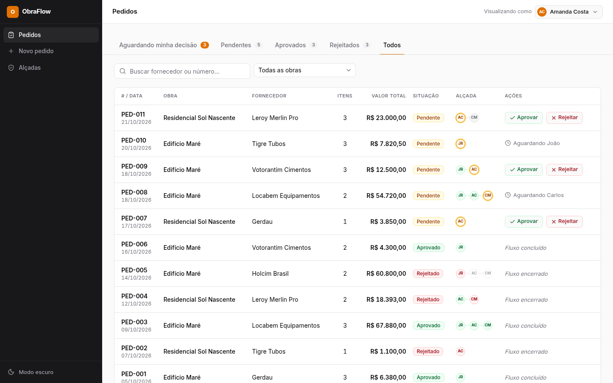

## Sumário

- [Como rodar](#como-rodar)
- [Telas](#telas)
- [Decisões técnicas](#decisões-técnicas)
- [API](#api)
- [Testes](#testes)
- [O que mudaria em produção](#o-que-mudaria-em-produção)

---

## Como rodar

### Com Docker (um comando)

Pré-requisito: Docker com Compose v2 (e BuildKit, padrão nas versões atuais).

```bash
docker compose up --build
```

| Serviço | Endereço |
|---|---|
| Front-end | http://localhost:3030 |
| API | http://localhost:3333/api |
| Swagger (documentação interativa) | http://localhost:3333/api/docs |
| PostgreSQL | `localhost:5433` (usuário/senha/banco: `obraflow` / `obraflow` / `dokimos`) |

Na primeira subida a API aplica as migrations e **carrega os dados de demonstração automaticamente** (só quando o
banco está vazio — reiniciar os containers não apaga o que foi cadastrado).

### Desenvolvimento local

Pré-requisitos: Node 22+, pnpm 11 (`corepack enable`) e Docker (para o Postgres).

```bash
pnpm install
cp apps/api/.env.example apps/api/.env
cp apps/web/.env.example apps/web/.env.local
pnpm db:up          # Postgres em localhost:5433
pnpm db:migrate     # aplica as migrations
pnpm db:seed        # dados de demonstração (apaga e recria tudo)
pnpm dev:api        # API em http://localhost:3333/api
pnpm dev:web        # front em http://localhost:3030
```

### Dados de demonstração

Não há login: o seletor **“Visualizando como”** (canto superior direito) simula quem está usando o sistema. Ele
define o solicitante de um novo pedido e quem vê os botões de aprovar/rejeitar.

| Usuário | Cargo | Papel no seed |
|---|---|---|
| Beatriz Lima | Compradora | solicitante (persona inicial) |
| João Ribeiro | Engenheiro de obra | 1º aprovador no Edifício Maré |
| Amanda Costa | Gerente de suprimentos | aprovadora nas duas obras |
| Carlos Mendes | Diretor financeiro | aprovador dos valores altos |
| Fernando Souza | Coordenador de obra | solicitante |

| Obra | Faixas de alçada | Cobertura |
|---|---|---|
| Edifício Maré | até R$ 10.000 → João · até R$ 50.000 → João → Amanda · acima → João → Amanda → Carlos | total |
| Residencial Sol Nascente | até R$ 5.000 → Amanda · até R$ 30.000 → Amanda → Carlos | parcial (acima de R$ 30.000 é bloqueado) |
| Torre das Artes | nenhuma | nenhuma (pedidos bloqueados) |

São 11 pedidos em todos os estados: 5 pendentes (em etapas diferentes da alçada), 3 aprovados e 3 rejeitados — um
deles rejeitado na 1ª etapa, para mostrar as etapas que não chegaram a acontecer.

**Roteiro rápido:** como *Amanda*, abra *Pedidos → Aguardando minha decisão*, aprove um pedido e rejeite outro
(o motivo é obrigatório). Em *Novo pedido*, monte um pedido no Residencial Sol Nascente acima de R$ 30.000 para ver
o bloqueio por falta de faixa; depois crie a faixa “sem limite” em *Alçadas* e tente de novo.

---

## Telas

<table>
<tr>
<td width="50%"><b>Pedidos — detalhe com itens e histórico</b><br>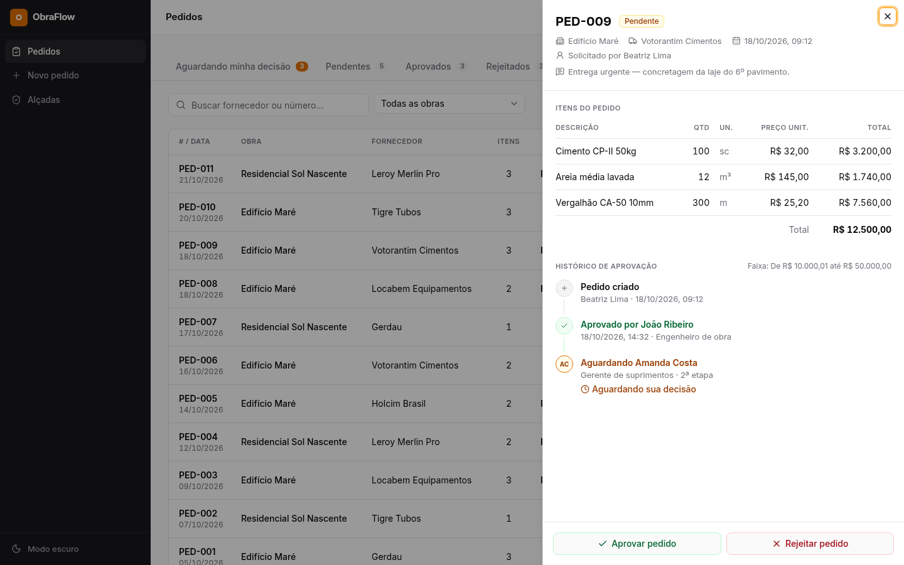</td>
<td width="50%"><b>Rejeição exige motivo (validado antes do envio)</b><br>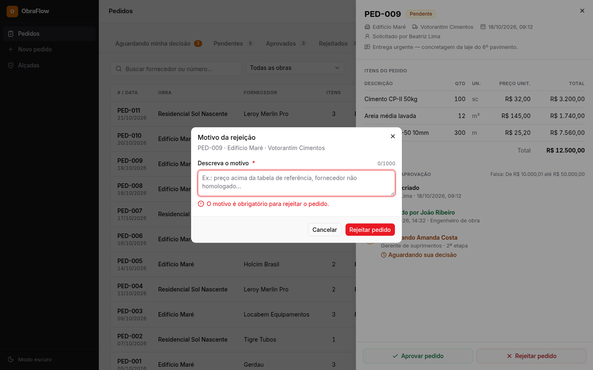</td>
</tr>
<tr>
<td><b>Pedido rejeitado: ações desabilitadas com explicação</b><br>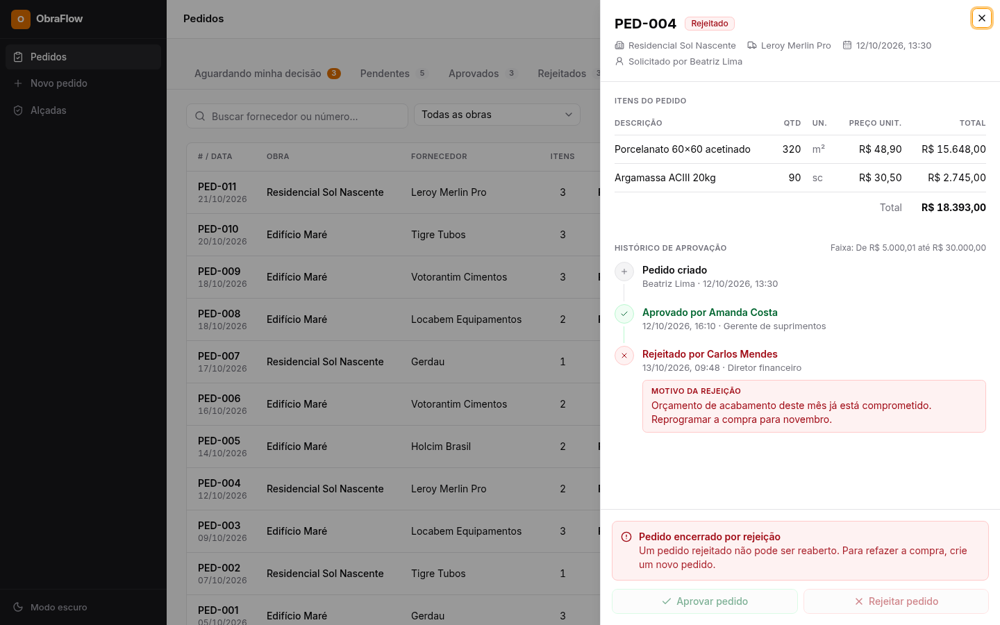</td>
<td><b>Novo pedido: totais ao vivo e prévia da cadeia</b><br>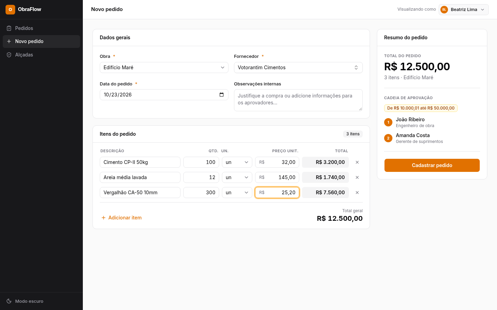</td>
</tr>
<tr>
<td><b>Novo pedido: erros por campo e lista de pendências</b><br>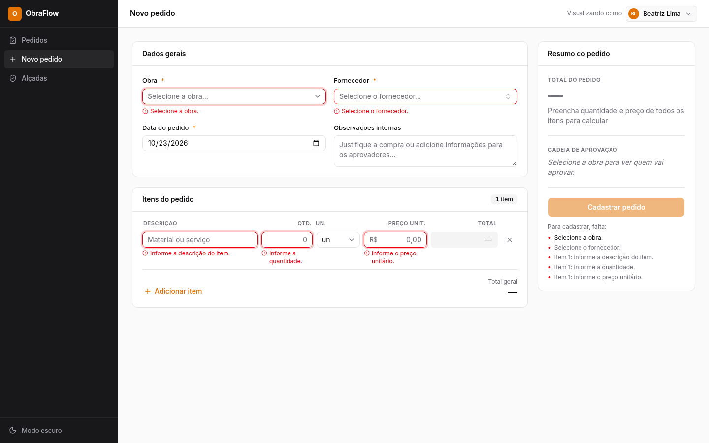</td>
<td><b>Novo pedido: valor sem faixa de alçada é bloqueado</b><br>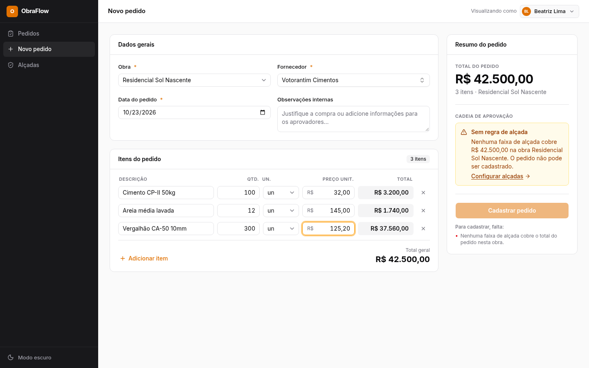</td>
</tr>
<tr>
<td><b>Alçadas: régua de cobertura e faixas por obra</b><br>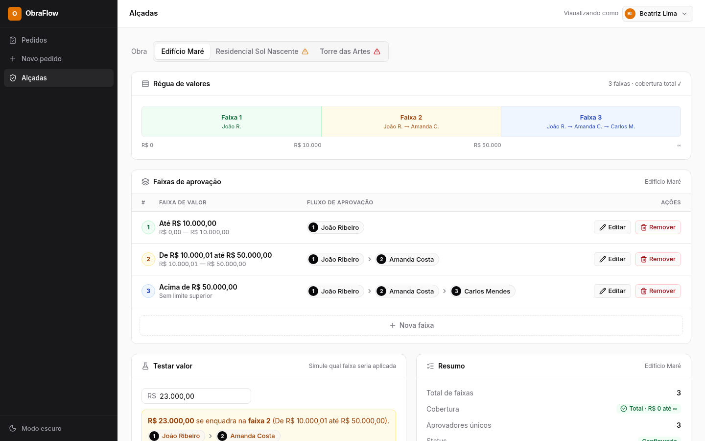</td>
<td><b>Alçadas: obra sem faixa “sem limite”</b><br>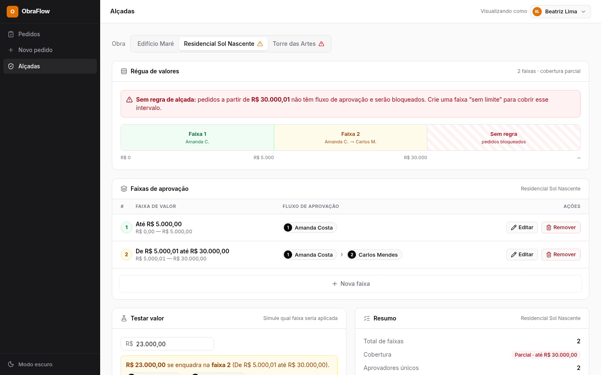</td>
</tr>
<tr>
<td><b>Alçadas: editar faixa e reordenar aprovadores</b><br>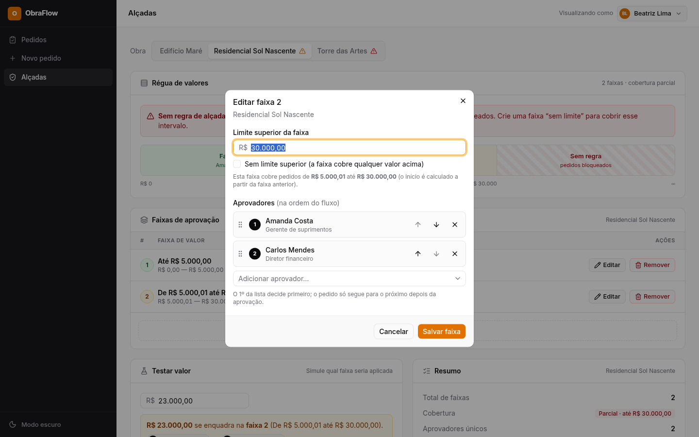</td>
<td><b>Modo escuro</b><br>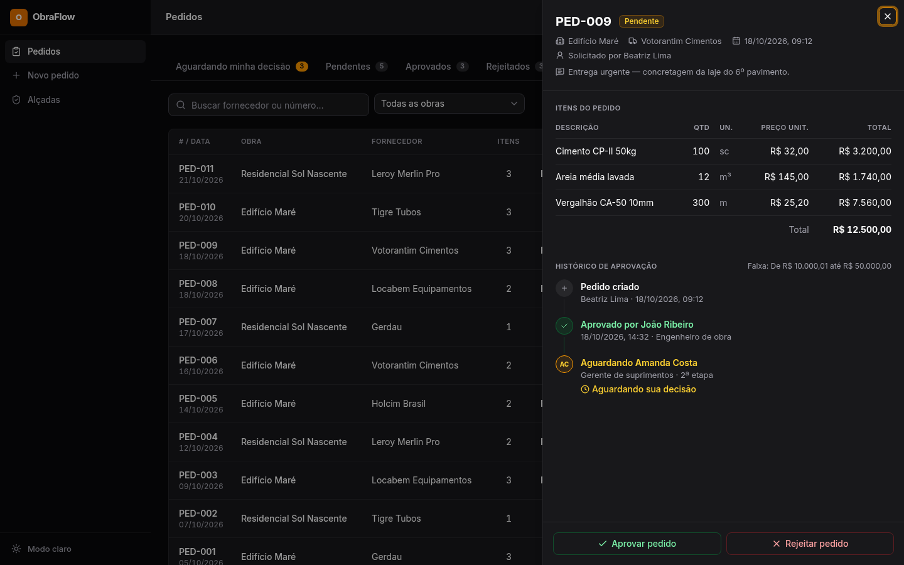</td>
</tr>
</table>

<p>
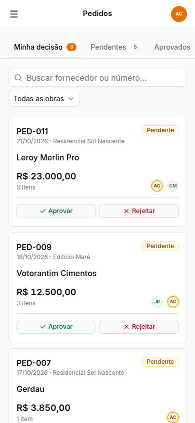
&nbsp;
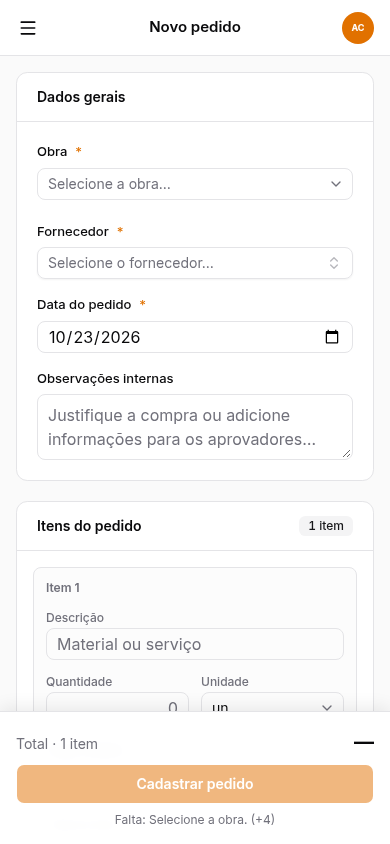
</p>

O design das telas foi feito antes do código ([prompts e canvas em `docs/design/`](docs/design/)); os estados de
carregando, vazio e erro existem em todas as listas.

---

## Decisões técnicas

### Tecnologias e por quê

| Camada | Escolha | Motivo |
|---|---|---|
| Back-end | **NestJS** | Estrutura modular (controller → service → mapper), injeção de dependência e validação declarativa; é a stack que eu domino. |
| ORM | **Prisma 7** | Schema legível, migrations versionadas, tipos gerados a partir do banco e transações interativas (necessárias para o controle de concorrência). |
| Banco | **PostgreSQL** | Transações sólidas, `numeric` exato para dinheiro, `CHECK`s e índice único com `NULLS NOT DISTINCT` (usado nas faixas). |
| Front-end | **Next.js 16 + React 19** | App Router, rotas por tela e build de produção autocontido (`standalone`) para a imagem Docker. |
| UI | **Tailwind v4 + shadcn/ui (Radix)** | Componentes acessíveis (dialogs, selects, combobox) que pertencem ao projeto e seguem os tokens do design. |
| Dados no front | **TanStack Query** | Cache, estados de loading/erro, retry e invalidação após mutações — cobre os estados obrigatórios das listas. |
| Formulários | **react-hook-form + zod** | Validação por campo (inclusive dentro de listas de itens) com as mesmas regras e mensagens da API. |
| Dinheiro | **decimal.js** | Mesmo tipo do Prisma; nada de `float` em nenhuma camada. |
| Testes | **Vitest + Playwright** | Unitários das regras, e2e da API com banco real e e2e do front em navegador. |
| Monorepo | **pnpm workspaces** | Um install, scripts centralizados, e o pnpm impede dependências “fantasmas”. |

### Como a alçada é modelada, calculada e persistida

**Faixas com cadeia explícita.** Cada obra tem N faixas; cada faixa define a cadeia completa de aprovadores em ordem.
O pedido cai em **exatamente uma faixa** (as faixas não acumulam). O exemplo do enunciado é ambíguo (“acima de
R$ 10.000 → Amanda”, mas o texto diz “João, depois Amanda”); a cadeia explícita é a leitura mais previsível e é a que
a tabela da tela 3 do enunciado sugere (`Amanda → João` numa única linha).

**A faixa guarda só o limite superior.** `ApprovalRule.maxAmount` (`null` = sem limite). O início de cada faixa é
**calculado**: ordenando por limite, a faixa cobre `(limite da anterior, maxAmount]`, e a primeira começa em R$ 0,00.
Com isso **não existem buracos nem sobreposições por construção** — com `min` e `max` digitados, alguém poderia
cadastrar “0–10.000” e “15.000–50.000” e deixar um pedido de R$ 12.000 sem regra.

```
maxAmount:  10.000,00 │ 50.000,00 │ null
cobertura:  0,00–10.000,00 │ 10.000,01–50.000,00 │ acima de 50.000,00
```

**Cálculo.** A resolução da faixa é uma função pura (`resolveRule`, em `apps/api/src/common/domain/approval-rules.ts`)
usada em três lugares: na criação do pedido, na prévia do formulário e no “Testar valor” — a prévia nunca diverge do
resultado real. O valor usado é o **total do pedido**, calculado no back-end (`quantidade × preço` por item,
arredondado a centavos, somado). Totais enviados pelo cliente são ignorados.

**Persistência e fluxo.**

```
Project ─< ApprovalRule ─< ApprovalRuleApprover >─ User        (configuração: faixas + cadeia)
   └──< PurchaseOrder ─┬─< PurchaseOrderItem                    (cabeçalho + itens, totais gravados)
                       ├─< ApprovalStep >─ User                 (cópia da cadeia no pedido)
                       └─< PurchaseOrderEvent >─ User           (histórico append-only)
```

- **Cópia da cadeia no pedido.** Ao criar, os aprovadores da faixa são copiados para `ApprovalStep` (1ª etapa
  `PENDING`, demais `WAITING`), e o pedido guarda a faixa aplicada (`ruleFromAmount`/`ruleMaxAmount`). Editar ou
  remover uma faixa depois **não altera** pedidos existentes.
- **Nível atual persistido.** `PurchaseOrder.currentStep` guarda a etapa da vez; a aba “Aguardando minha decisão” e
  os botões da lista leem esse campo calculado pelo back-end.
- **Máquina de estados pura** (`apps/api/src/common/domain/approval-flow.ts`): aprovar avança para a próxima etapa (a
  última aprova o pedido); rejeitar encerra o fluxo, marca as etapas seguintes como `SKIPPED` e exige motivo.
- **Histórico append-only.** `PurchaseOrderEvent` só recebe inserts (`CREATED`, `APPROVED`, `REJECTED` com motivo):
  é a trilha auditável de quem decidiu, quando e por quê.

**Valor sem regra aplicável.** O pedido **não é criado** (`422 NO_APPROVAL_RULE`, com mensagem clara). O formulário
avisa antes do envio, mostra um link para *Alçadas* e mantém o botão desabilitado. Obras sem faixa “sem limite” ou sem
faixas aparecem com alerta na tela de alçadas (régua com o trecho “Sem regra”).

### Como o front-end se comunica com o back-end

- **HTTP + JSON** (REST), com contrato escrito antes do código: [`docs/api-contract.md`](docs/api-contract.md) e Swagger.
- O navegador chama a API diretamente (`NEXT_PUBLIC_API_URL`, CORS liberado para a origem do front).
- Camada de dados em `apps/web/src/lib/api/`: tipos espelhando o contrato, um cliente que transforma qualquer erro
  em `ApiError`, uma função por rota e hooks do TanStack Query com chaves de cache centralizadas. Mutações
  invalidam o cache correspondente (aprovar atualiza lista, contadores e detalhe de uma vez).
- **Erros em formato único:** `{ statusCode, code, message, details }`. Em erros de validação, `details[].field` traz o
  caminho exato (`items.1.quantity`), que é o mesmo caminho do campo no formulário — o erro aparece na linha certa.
- **Dinheiro trafega como string decimal** (`"12500.00"`) nas duas direções: o JSON só tem número em ponto
  flutuante. No banco é `numeric`, no back-end `Decimal`; no front, a prévia usa as mesmas regras de arredondamento
  (com testes de paridade).

### Como a consistência e a integridade dos dados são garantidas

- **Transações:** criar um pedido grava cabeçalho, itens, etapas e histórico numa única transação (`RepeatableRead`,
  para faixa e aprovadores serem lidos da mesma “foto” do banco); decidir atualiza pedido, etapas e histórico juntos.
- **Concorrência nas decisões (lock otimista):** o cliente envia o `stepId` que está vendo e a atualização é
  condicional (`WHERE status = 'PENDING' AND currentStep = X`). Se duas decisões chegarem juntas, só uma é aplicada;
  a outra recebe `409` (o front avisa e recarrega). Há teste e2e com 5 aprovações simultâneas.
- **Restrições no próprio banco** (defesa em profundidade, mesmo se houver bug na API): índice único
  `(projectId, maxAmount) NULLS NOT DISTINCT` (nada de dois limites iguais nem duas faixas “sem limite”), `CHECK`s de
  quantidade > 0, preço e totais ≥ 0, pedido pendente sempre com etapa atual, rejeição sempre com motivo, e chaves
  estrangeiras `RESTRICT` para não apagar quem aparece no histórico.
- **Validação nas duas pontas:** DTOs com class-validator na API (campos desconhecidos são descartados), zod no front
  com as mesmas regras; limites de tamanho dos números e dos ids validados para nunca virarem erro 500.

### Outras decisões de produto

- **“Visualizando como” em vez de login:** o enunciado não pede autenticação; a simulação de personas deixa o fluxo
  da alçada fácil de avaliar (quem não é o aprovador da vez vê os botões desabilitados com o motivo).
- **Nada de “faltam R$ X para mudar de faixa”** no formulário: incentivaria o fracionamento de compras, exatamente o
  que a alçada existe para evitar.
- **Estado das listas na URL** (`?aba=minha&pedido=9`): recarregar mantém a tela, e o cadastro volta para a lista
  destacando o pedido criado.

### Estrutura do repositório

```
apps/
  api/   NestJS — src/{users,projects,suppliers,approval-rules,purchase-orders}, src/common/{domain,errors,prisma,validation}
         prisma/ (schema, migrations, seed)
  web/   Next.js — src/app (rotas), src/features/{purchase-orders,new-order,approval-rules}, src/lib/api, e2e/ (Playwright)
docs/    contrato da API, PRD, design (prompts, canvas e PNGs), screenshots e o enunciado original
```

---

## API

Base: `http://localhost:3333/api` · documentação interativa em `/api/docs` · contrato completo, com todos os payloads e
códigos de erro, em [`docs/api-contract.md`](docs/api-contract.md).

| Método | Rota | Descrição |
|---|---|---|
| GET | `/health` | API e banco no ar (503 se o banco cair) |
| GET / POST | `/users` | Usuários |
| GET / POST | `/projects` | Obras (com quantidade de faixas e cobertura) |
| GET / POST | `/suppliers?q=` | Fornecedores (busca por nome) |
| GET / POST | `/projects/:projectId/approval-rules` | Faixas da obra (com início calculado e cobertura) / criar faixa |
| GET | `/projects/:projectId/approval-rules/resolve?amount=` | Prévia: faixa e cadeia para um valor |
| PUT / DELETE | `/approval-rules/:id` | Editar (limite + cadeia; reordenar = enviar a nova ordem) / remover faixa |
| GET | `/purchase-orders?status=&projectId=&awaitingUserId=&q=&page=&pageSize=` | Lista com contadores das abas |
| POST | `/purchase-orders` | Cria pedido (calcula totais e monta a cadeia) |
| GET | `/purchase-orders/:id` | Detalhe: itens, etapas e histórico |
| POST | `/purchase-orders/:id/approve` | Aprova a etapa atual — corpo `{ "stepId": 32 }` |
| POST | `/purchase-orders/:id/reject` | Rejeita — corpo `{ "stepId": 32, "reason": "…" }` (mín. 10 caracteres) |

<details>
<summary>Exemplo: criar pedido</summary>

```http
POST /api/purchase-orders
Content-Type: application/json

{
  "projectId": 1,
  "supplierId": 1,
  "requesterId": 4,
  "orderDate": "2026-10-23",
  "notes": "Concretagem agendada para sexta-feira.",
  "items": [
    { "description": "Cimento CP-II 50kg", "quantity": "100", "unit": "sc", "unitPrice": "32.00" },
    { "description": "Areia média", "quantity": "12.5", "unit": "m3", "unitPrice": "145.00" }
  ]
}
```

Resposta `201`: o pedido completo — `code` (`"PED-012"`), `totalAmount` (`"5012.50"`), `items` com `total` calculado,
`steps` (`[{ "position": 1, "status": "PENDING", "approver": { "name": "João Ribeiro", … } }]`), `appliedRule` e
`history`. Sem faixa para o total: `422 { "code": "NO_APPROVAL_RULE", "message": "Nenhuma faixa de alçada cobre … " }`.
</details>

<details>
<summary>Exemplo: criar faixa</summary>

```http
POST /api/projects/2/approval-rules
Content-Type: application/json

{ "maxAmount": null, "approverIds": [3, 2] }
```

`maxAmount: null` = “sem limite”; a ordem de `approverIds` é a ordem do fluxo. Limite repetido →
`409 DUPLICATE_LIMIT`; segunda faixa sem limite → `409 UNLIMITED_RULE_EXISTS`.
</details>

---

## Testes

```bash
pnpm test                 # unitários: regras de domínio (API) + dinheiro, formatação e formulários (front)
pnpm test:api:e2e         # API inteira contra um banco de teste separado (dokimos_test) — requer `pnpm db:up`
pnpm test:web:e2e         # navegador (Playwright): sobe API e front próprios para teste, desktop e celular
```

| Suíte | Cobertura | Testes |
|---|---|---|
| API · unitários | limites exatos das faixas, cobertura, máquina de estados, arredondamento | 26 |
| API · e2e | criação com alçada, validações, aprovação/rejeição, 409, concorrência, cópia da cadeia | 35 |
| Front · unitários | paridade de cálculo com o back-end, schema do pedido, rascunho de faixa | 23 |
| Front · e2e | as 3 telas, estados de loading/vazio/erro, conflito, responsividade (sem rolagem horizontal) | 31 |

Os e2e nunca tocam o banco de desenvolvimento. Para o Playwright, use um Chromium instalado
(`PLAYWRIGHT_CHROMIUM_PATH=/caminho/do/chrome`) ou `pnpm --filter @obraflow/web exec playwright install chromium`.

---

## O que mudaria em produção

- **Autenticação e autorização:** login (OIDC/JWT) e o back-end validando que quem decide é o aprovador da etapa —
  hoje a persona é simulada no front. Perfis para restringir a configuração de alçadas.
- **Segregação de funções:** impedir que o solicitante aprove o próprio pedido e registrar substitutos (férias,
  ausências) com delegação temporária e auditada.
- **Notificações** (e-mail/push) quando um pedido chega à etapa de alguém, e lembretes de pedidos parados.
- **Versionamento das faixas** (vigência por data) em vez de edição direta, para auditoria das regras ao longo do tempo.
- **Pedidos:** edição/cancelamento antes da 1ª aprovação, anexos (cotações) e integração com o restante do ERP.
- **Operação:** logs estruturados com correlação de requisições, métricas e tracing (OpenTelemetry), rate limiting,
  headers de segurança, CI rodando lint e todas as suítes, migrations aplicadas por job dedicado e backups do banco.
- **Escala:** paginação por cursor e índices revisados conforme o volume; filas para efeitos colaterais (notificações,
  integrações) fora da transação da decisão.

---

## Documentação do projeto

| Documento | Conteúdo |
|---|---|
| [`docs/DESAFIO.md`](docs/DESAFIO.md) | Enunciado original do desafio |
| [`docs/api-contract.md`](docs/api-contract.md) | Contrato da API: rotas, payloads, erros e modelo da alçada |
| [`docs/prd.md`](docs/prd.md) | PRD enxuto: critérios de aceite (todos verificados), plano e riscos |
| [`docs/design/`](docs/design/) | Prompts do design, canvas exportado e PNGs de referência |

---

Rafael Vieira · rafaelvieira@ufba.br
